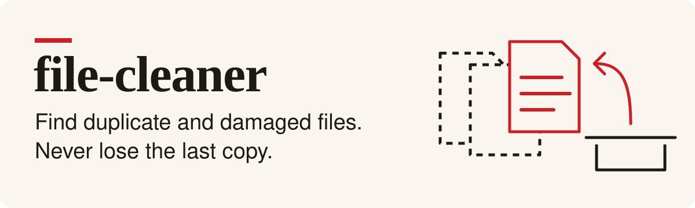
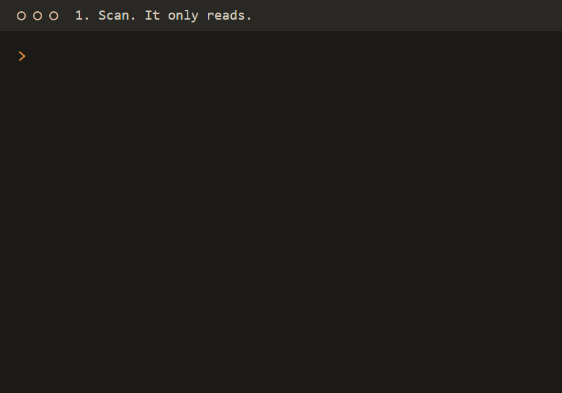

<picture>
  <source media="(prefers-color-scheme: dark)" srcset="assets/banner-dark.svg">
  
</picture>

[](https://github.com/zed-dz/file-cleaner/actions/workflows/ci.yml)

**Get space back from duplicate files, and put everything back if you change your mind.**



## Who it is for

- You have years of downloads, backups and phone photos on one drive.
- You want the space back, and you are scared of deleting the only copy.
- You do not want to install an app or upload anything.

## Install

You need [Python](https://www.python.org/downloads/) 3.9 or newer. It is one file and it needs nothing else.

```sh
curl.exe -LO https://github.com/zed-dz/file-cleaner/releases/latest/download/file_cleaner.py
python file_cleaner.py scan "D:\Photos"
```

That is for Windows. On macOS and Linux, type `curl`, `python3` and a path like `~/Photos`.

## What it does

**1. Scan.** It only reads. It writes a report you can open.

```sh
python file_cleaner.py scan "D:\Photos"
```

**2. Dry run.** It lists each copy it would remove, and the copy it keeps. Nothing moves.

```sh
python file_cleaner.py delete --report file-cleaner-report.json
```

**3. Move the copies aside.** They go to a quarantine folder. Nothing is deleted.

```sh
python file_cleaner.py delete --report file-cleaner-report.json --apply
```

**4. Put them back**, if you want. First without `--apply` to look, then with it.

```sh
python file_cleaner.py restore --from file-cleaner-quarantine-20261125-101500 --apply
```

When you are sure, delete the quarantine folder yourself. That is when the space comes back.

It also lists **damaged files**: full of zero bytes after a bad sync, PDFs and JPGs cut short, Office and ZIP files that do not open. It never removes those.

| Option | What it does |
|---|---|
| `--protect PATH` | Scan this folder but never remove from it. Its copy is the one kept. Repeat it for more folders. |
| `--skip PATH` | Do not scan this folder at all. |
| `--keep shortest\|oldest\|newest` | Which copy to keep. Default: the shortest path. |
| `--quarantine DIR` | Where removed copies go. It must be outside the scanned folder. |
| `--report FILE` | Name of the report. |
| `--workers N` | How many files are read at the same time. Default 8. |
| `--hard` | Delete for good. Needs `--apply`. This cannot be undone. |

## Safety and privacy

- **Same content, not same name.** Two files are copies only if every byte matches.
- **Checked twice.** Each copy is compared byte for byte with the kept file right before it moves. If either one changed, it is skipped.
- **The last copy stays.** A copy in the recycle bin, a trash folder, a cache or an old quarantine never counts as the copy to keep.
- **Left alone:** Git projects, `node_modules`, Windows and program folders, photo library bundles, hard links, and online-only cloud files.
- **Links are not followed.** Symbolic links and Windows junctions cannot lead it out of your folder.
- **A crash can be undone.** The log is written one line at a time.
- **It never writes over your files.** Not with the report, not when it restores.
- **No network.** It has no code that goes online. Read it: one Python file, no other packages.

There are 38 tests. Most of them try to make it lose a file. Run them yourself:

```sh
git clone https://github.com/zed-dz/file-cleaner
cd file-cleaner
python -m unittest discover -s tests -v
```

## How it compares

I read these projects' own pages on 25 November 2026.

| | file-cleaner | [Czkawka / Krokiet](https://github.com/qarmin/czkawka) | [dupeGuru](https://github.com/arsenetar/dupeguru) | [fdupes](https://github.com/adrianlopezroche/fdupes) |
|---|---|---|---|---|
| Window to click in | no | yes | yes | no |
| Similar images and videos | no | yes | pictures | no |
| Finds damaged files | some types | yes, more types | no | no |
| Written in | Python, one file | Rust | Python and Qt | C |
| Command that puts files back | yes | I found none | I found none | I found none |

If you want a window, similar photos or more speed, use Krokiet. It is very good. Use file-cleaner if you want something small you can read, with an undo.

## Limits

- Exact copies only. Two sizes of the same photo are two different files to it.
- The damage check looks at the start and the end of a file. It can miss damage in the middle. Some phone "motion" photos can be listed by mistake.
- It does not free space by itself. Quarantine moves files. You delete the folder.
- If you scan a whole drive, quarantine needs another drive. Files are then copied, checked, and removed from the first one. Windows alternate data streams are not carried across.
- No window, no scheduler.

## Contributing

Read [CONTRIBUTING.md](CONTRIBUTING.md). If you found a way to make it lose a file, see [SECURITY.md](SECURITY.md).

## Licence

[MIT](LICENSE). Made by Amine Hammou. More tools: https://aminehammou.vercel.app/tools.html
